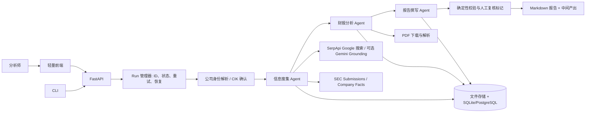

# Agent 驱动的自动化投研系统：技术设计

> 版本：v1.1
> 状态：代码已实现，在线投研与规模化评测待配置凭证后验证；本文中的成功率和效率数据均为验收目标，不代表已测得结果。

## 1. 项目定位与范围

输入美国上市公司名称或股票代码，系统自动确认公司身份，获取公开资料和 SEC 财报数据，计算财务指标，生成带来源、可供分析师复核的中文投研初稿。目标用户是投资分析师；报告是研究辅助材料，不自动给出买卖指令或执行交易。

**MVP 输入**：`company_name`（必填）、`ticker`（可选）、`as_of_date`（默认运行日）、`report_periods`（默认最近 3 个完整财年和最近 4 个季度）、`report_language`（默认中文）。  
**MVP 输出**：`report.md`、结构化指标 `metrics.json`、来源索引 `sources.json`、每一步的中间产出和执行日志。  
**覆盖范围**：优先支持以 10-K/10-Q 和 US GAAP XBRL 披露的美国非金融上市公司。银行、保险、REIT、ADR/20-F、缺少标准 XBRL 的公司先标为“需人工复核”，不计入首版主验收样本。此范围在提交任务前展示，不在运行后随意剔除失败案例。

### 1.1 关键验收指标

| 指标 | 定义与目标 |
| --- | --- |
| 端到端成功率 | 在预先冻结的适用公司样本中，按时生成报告且通过第 6 节全部质量门槛的运行数 / 发起运行数，目标 **>95%**。超时、错误、无法核实的关键数据均计失败。 |
| 数值准确率 | 核心指标与 SEC/XBRL 原始事实及确定性计算复核一致率 ≥99%；分母是评测集中全部核心指标，不只统计已输出的指标。 |
| 引用覆盖率 | 报告中的可核实事实和数值声明，带可打开来源的比例 ≥95%；核心财务数值必须 100% 有来源。 |
| 时效性 | 报告显示资料截止时间、最新财报期和检索时间；最近财报是否获取成功应单独标记。 |
| 效率提升 | 用同样的任务口径对比人工基线与“系统生成 + 分析师核验修改”的主动工时；目标 ≥50%。 |

## 2. 总体架构



**技术栈**：后端采用 Python 3.11+、CrewAI、Pydantic、FastAPI、HTTPX、PyMuPDF、pandas（仅数据整理）、SQLite（本地）/ PostgreSQL（部署）和结构化 JSON 日志。前端采用 React + TypeScript + Vite，使用轻量 CSS 组件即可。CLI 保留用于开发和批量评测；演示版包含前端，报告格式为 Markdown，PDF 导出属于后续阶段。

**编排原则**：外层 Run 管理器严格顺序调度 3 个 CrewAI Agent 阶段，每阶段以 `Crew(process=Process.sequential)` 执行一个结构化 `Task`，并在阶段间保存检查点。这种阶段级 Crew 使失败后能够从最近检查点恢复。CrewAI 的 `output_pydantic` 和 `guardrail` 用于结构化输出与任务级质量门槛；外层仍负责身份解析、跨任务恢复、网络重试和终态判定。见 [CrewAI Tasks](https://docs.crewai.com/en/concepts/tasks) 和 [Crews](https://docs.crewai.com/en/concepts/crews)。

### 2.1 顺序工作流与检查点

| 阶段 | 执行者 | 输入 | 中间产出 | 放行条件 |
| --- | --- | --- | --- | --- |
| 0. 身份解析 | 确定性服务 | 公司名/代码 | `00_company.json` | 唯一 CIK、ticker、法定名称；歧义则暂停并提示用户选公司 |
| 1. 信息搜集 | 信息搜集 Agent | 公司身份、截止日 | `01_research.json`、`sources.json` | 至少 1 份 SEC 原始申报及 2 个相关可信来源；所有发现保留 URL/时间 |
| 2. 财报分析 | 财报分析 Agent + 确定性计算器 | 申报/XBRL/PDF | `02_facts.json`、`02_metrics.json`、`02_analysis.json` | 单位、期间、币种核对；核心数字可追溯；缺项明确标注 |
| 3. 报告撰写 | 报告撰写 Agent | 研究与分析结果 | `03_report_draft.md` | 固定章节齐全，每项重要判断能回链到证据 |
| 4. 质量校验 | 确定性服务 | 报告及全部产出 | `04_validation.json`、`report.md` | 数值、引用、时间及章节检查通过；否则回退到相关阶段或标记人工复核 |

每个阶段只读取上游**已通过校验**的产出。阶段成功后以临时文件写入并原子替换正式文件，同时更新数据库中的 `run_id + stage + status + attempt + artifact_hash`。恢复执行时校验输入哈希和版本；匹配则复用已完成阶段，否则从最早受影响阶段重跑。一次运行保留原始响应与最终规范化数据，避免审计时只看到改写后的文本。

## 3. Agent 职责和工具设计

### 3.1 Agent 配置

| Agent | 任务边界 | 允许工具 | 交付物 |
| --- | --- | --- | --- |
| 信息搜集 Agent | 找到最新公告、业务概况、行业与风险；筛选来源并标注发布时间 | SerpApiSearchTool（或 GoogleSearchTool）、SecSubmissionsTool、SecCompanyFactsTool、SourceFetchTool | `ResearchBundle`：公司、资料目录、带来源的事实卡片、信息缺口 |
| 财报分析 Agent | 对财报内容做解释，选择需计算的指标，解释变化和风险 | SecCompanyFactsTool、FilingDownloadTool、PdfExtractTool、MetricCalculatorTool | `FinancialAnalysis`：原始事实引用、指标、同比/趋势、异常和限制 |
| 报告撰写 Agent | 根据前两阶段结果生成研究初稿，不自行创造数字 | ArtifactReadTool、CitationResolverTool、ArtifactWriteTool | 带来源的 Markdown 报告和未解决问题清单 |

Agent 只调用白名单工具；LLM 不直接写最终指标值。数值运算与期间匹配由确定性代码完成，Agent 负责提出分析假设、解释和组织文字。报告中的“推断”与“原始披露事实”应明显区分。

### 3.2 至少 5 个具体工具

| 工具 | 输入 → 输出 | 失败/边界处理 |
| --- | --- | --- |
| `SerpApiSearchTool` | 查询词、截止日 → Google 自然搜索结果、来源 URL、标题、片段 | 默认搜索工具；只把片段作为发现线索，保留来源 ID、查询和结果，不将片段当成已核实的网页全文 |
| `GoogleSearchTool` | 查询词、截止日 → Gemini Grounding 摘要、来源 URL、标题 | 可选兼容工具；使用 Gemini API 并保存 grounding 引用 |
| `SecTickerCikTool` | 公司名/代码 → CIK 候选 | 严格匹配并记录候选；同名公司不自动猜测 |
| `SecSubmissionsTool` | CIK → 申报列表、accession、10-K/10-Q 路径 | 使用声明身份的 User-Agent、全局限速和缓存 |
| `SecCompanyFactsTool` | CIK → XBRL facts | 保留 taxonomy、concept、unit、form、fy/fp、start/end、filed、accession；禁止直接跨期间相加 |
| `FilingDownloadTool` | 申报 URL → 本地原件、SHA-256 | 限制文件类型/大小、校验响应内容；支持 HTML 和 PDF |
| `PdfExtractTool` | PDF 路径 → 逐页文本、页码、表格片段 | 扫描件/OCR 失败时标记人工复核；绝不把无页码文本当可审计来源 |
| `MetricCalculatorTool` | 标准化事实 → 指标、公式、操作数与精度 | 纯代码计算；分母为零/缺数返回 `unavailable` |
| `ArtifactReadTool` / `ArtifactWriteTool` | run_id、相对路径 → 读写版本化文件 | 限制在本次运行目录，禁止路径穿越，写入原子化 |
| `CitationResolverTool` | source_id / filing_id → URL、页码/概念/期间 | 来源失效或不存在则阻止相应断言发布 |

Google 的 **Custom Search JSON API 已不向新客户开放**，已有客户也面临停用计划，因此新项目不以它作为默认依赖。默认搜索工具是第三方 [SerpApi Google Search API](https://serpapi.com/search-api)，返回 Google 自然结果的标题、链接和片段，再由独立的 OpenAI Agent 分析；它不是 Google 官方接口。可选 `GoogleSearchTool` 使用 [Gemini Google Search Grounding](https://ai.google.dev/gemini-api/docs/google-search)，返回模型加工的摘要和引用。两种搜索均受每次运行查询预算限制。更多约束见 [Google Custom Search 公告](https://developers.google.com/custom-search/v1/overview)。

SEC 的 [Submissions / XBRL API](https://www.sec.gov/search-filings/edgar-application-programming-interfaces) 无需 API key。依照 [SEC Developer Resources](https://www.sec.gov/about/developer-resources) 和 [Developer FAQ](https://www.sec.gov/about/webmaster-frequently-asked-questions)，请求须声明 User-Agent、缓存、限速；统一共享限流器配置为 **≤8 req/s**，给 SEC 官方 10 req/s 上限留余量。10-K/10-Q 原件可能为 HTML，因此 PDF 解析只处理实际下载到的 PDF 年报/附件，**财务数值以 XBRL/申报原文为优先来源**。

## 4. 数据契约与计算规则

### 4.1 核心结构

```text
RunRequest: company_name, ticker?, as_of_date, periods, language
CompanyIdentity: cik, ticker, legal_name, exchange?, confidence, candidates[]
Source: source_id, type, title, url, publisher, published_at?, fetched_at,
        filing_accession?, pdf_page?, xbrl_concept?, content_hash
Fact: name, value, unit, currency?, start?, end, fy?, fp?, form,
      filed_at, accession, source_id, taxonomy, concept
Metric: name, value?, unit, period, formula, operand_fact_ids[],
        status(verified|unavailable|needs_review), reason?
Claim: text, kind(fact|inference), source_ids[], metric_ids[]
Run: run_id, request_hash, status, stage, attempts, started_at,
     finished_at?, error_code?, artifact_manifest[]
```

所有产出通过 Pydantic schema 校验，字段缺失直接失败；每条关键事实必须绑定来源 ID。`Source` 保留下载时间和内容哈希，以便复现。跨文档同一指标出现冲突时，优先最新正式申报；保留旧值和冲突记录，不静默覆盖。修订版申报需以 accession 与 filed_at 区分。

### 4.2 首版指标

| 指标 | 计算口径 | 防错点 |
| --- | --- | --- |
| 营收同比 | `(本期营收 / 上年同期间营收 - 1) × 100%` | 必须同一季度或同一财年、相同币种和单位 |
| 毛利率 | `(营收 - 营业成本) / 营收 × 100%` | 缺营业成本则不计算；有直接披露的毛利可对照 |
| 营业利润率 | `营业利润 / 营收 × 100%` | 先确认概念口径一致 |
| 净利率 | `归母净利润 / 营收 × 100%` | 明确采用归母还是合并净利润 |
| 自由现金流 | `经营活动现金流 - 资本开支` | 资本开支取现金流出绝对值；披露口径差异须注明 |
| 现金流/净利润 | `经营活动现金流 / 归母净利润` | 分母为 0 或亏损时返回“不可解释/需复核” |

季度值若 SEC 披露为年初至今累计，需要按相同财年的累计值相减得到单季值，并记录两笔原始事实；不要把累计值直接当季度值。若公司采用非标准概念或美元以外币种，需配置映射并复核。每个计算结果存公式、操作数、来源和舍入规则，报告只引用这一份指标结果。

## 5. 可靠性、重试与恢复

| 故障 | 处理策略 | 最终结果 |
| --- | --- | --- |
| 网络超时、429、5xx | HTTP 层最多 3 次指数退避 + 抖动，尊重 `Retry-After`；每工具设置连接/读取超时 | 仍失败则转为阶段失败，保留诊断信息 |
| SEC/搜索限额 | 限流、缓存、同一 URL 请求去重；搜索预算用尽时只用已有已验证来源 | 不满足来源门槛则失败 |
| LLM JSON 不合 schema | CrewAI task guardrail 最多 2 次修复；仍失败则阶段最多重跑 1 次 | 不输出未校验的报告 |
| PDF 损坏、扫描件无法读 | 尝试 SEC HTML/XBRL 原文；记录 `pdf_parse_failed` | 数值仍可核实时继续，否则需人工复核 |
| 数据缺失、期间冲突 | 停止该指标计算，形成缺口/冲突记录 | 核心指标缺失则不能算端到端成功 |
| 进程中断 | 检查点恢复，仅重跑受影响阶段 | 避免重复付费调用和重复覆盖产出 |

**超时预算**：单工具请求 15–30 秒，单阶段 5 分钟，单次运行 15 分钟（首版可配置）。外层阶段重试为幂等重试；`run_id` 不变，`attempt` 递增。只有临时性错误可自动重试，参数不合法、身份歧义和数据口径冲突直接进入明确终态。触发降级时报告首页标出缺少的证据与不完整章节，不将降级报告计为成功。

**观测与审计**：每次工具调用记录 `run_id/stage/tool/attempt/latency/status/error_code`，对密钥和原始提示词中的敏感内容脱敏；汇总运行成功率、各阶段失败率、平均/95 分位耗时、每份报告的搜索/LLM 成本、引用缺失率。保留阶段产物与来源哈希，支持按 `run_id` 重放。日志不记录 API key。

## 6. 报告质量门槛

最终报告固定包含：摘要、公司与业务、最新披露与驱动因素、三年/四季财务表、盈利与现金流分析、主要风险、数据缺口、来源目录、资料截止时间。报告撰写 Agent 不得将搜索摘要当作财报原文，也不得在找不到证据时自行补数。

提交前执行以下自动检查：

1. **结构**：必需章节和 `as_of_date`、财报期齐全。
2. **数字**：扫描报告中引用的核心财务值，与 `Metric`/`Fact` 逐项比对；允许明确的展示舍入误差，单位必须一致。
3. **来源**：核心数值 100% 映射到 SEC source；其他事实性陈述可点击到原始来源。引用 URL 和 accession/页码/概念存在。
4. **时间**：不得把截止日之后的资料混入历史报告；旧闻不能标为“最新”。
5. **口径**：季度和累计、原币和换算币、归母和合并口径不混用。
6. **人工复核**：高影响但证据不足的推断写入待核验清单；报告状态为 `needs_review`，不归入成功。

## 7. API、目录与交付形态

### 7.1 前端页面与交互

前端面向分析师完成“提交任务 → 查看 Agent 进度 → 核验报告”的闭环，首版只做以下三个页面，不增加账户、交易、复杂图表或在线编辑功能。

| 页面与路由 | 核心内容 | 关键交互 |
| --- | --- | --- |
| 新建任务 `/` | 公司名/股票代码、截止日期、财报范围；最近任务列表 | 校验输入后提交；收到 `run_id` 即跳转详情页；身份歧义时展示候选公司供选择 |
| 任务详情 `/runs/:runId` | 5 个阶段的状态、耗时、重试次数、错误说明；每阶段中间产出摘要 | 运行中每 2 秒轮询状态；可展开来源与指标摘要；失败后从失败阶段重试；刷新页面后按 `run_id` 恢复视图 |
| 报告 `/runs/:runId/report` | Markdown 报告、财务指标表、引用来源、待人工复核事项 | 点击引用打开原始来源；下载 Markdown；从报告跳回对应阶段产出 |

**页面状态**：`queued`、`running`、`succeeded`、`needs_review`、`failed` 由后端统一定义。`needs_review` 显示醒目标记和具体缺口，不渲染为“完成成功”。身份歧义是 `needs_input` 状态，用户选择 CIK 后才继续。轮询遇到 429/5xx 做退避，进入终态立即停止；页面只读后端状态，不根据计时器推测 Agent 已完成。

**展示重点**：任务详情页用纵向阶段时间线呈现“输入、工具调用摘要、中间产出、校验结果”，让 Multi-Agent 协作可见。前端不展示模型内部推理或 API 密钥。来源卡片显示标题、机构、日期、原始 URL；指标卡片显示数值、单位、财报期和计算公式。报告中的外部链接在新标签打开，Markdown 渲染前进行清理，防止来源文本注入脚本。

### 7.2 前后端接口约定

```text
POST /runs  {company_name, ticker?, as_of_date?, report_periods?}
  -> 202 {run_id, status, detail_url}
GET  /runs?limit=20          -> 最近任务摘要列表
GET  /runs/{run_id}          -> 状态、当前阶段、阶段时间线、错误与校验摘要
GET  /runs/{run_id}/artifacts -> 可查看的中间产出摘要和来源索引
GET  /runs/{run_id}/report   -> Markdown 正文；未生成时返回 409
POST /runs/{run_id}/resolve-company {cik} -> 选择身份候选后继续
POST /runs/{run_id}/retry    -> 从失败阶段恢复（幂等）
```

`POST /runs` 只创建后台任务，不等待整份报告生成。所有错误响应使用统一结构 `{code, message, retryable, run_id}`；重试接口要求 `Idempotency-Key`，避免用户重复点击启动多个作业。`GET /runs/{run_id}` 返回每个阶段的 `status/started_at/finished_at/attempts/artifact_ids` 和报告状态；前端通过专门的产出接口读取摘要，不直接访问服务器文件路径。`GET /runs/{run_id}/report?download=1` 触发 Markdown 附件下载，响应设置安全的文件名和内容类型。若部署为独立前后端，限制 CORS 来源；本地演示可同源代理。

### 7.3 代码目录

```text
frontend/
  src/pages/             # 新建任务、任务详情、报告
  src/components/        # 阶段时间线、来源卡片、指标表、状态提示
  src/api/               # 类型化 API 客户端与轮询逻辑
  src/types/             # 与后端响应一致的类型
src/invest_research/
  api.py                # API/CLI 入口
  workflow.py           # 顺序 Crew 与阶段控制
  agents.py             # 3 个 Agent 与 Task
  schemas.py            # Pydantic 数据契约
  tools/                # Google、SEC、PDF、文件、计算工具
  metrics.py            # 确定性指标计算
  validation.py         # 报告质量门槛
  storage.py            # 检查点和原子写入
tests/fixtures/         # 固定申报、PDF 与网络错误样本
runs/{run_id}/           # 各阶段 JSON、原件、报告、manifest
```

配置包括 `CREWAI_MODEL`、对应提供方密钥（Gemini 或 OpenAI）、`SEARCH_PROVIDER`（默认 `serpapi`）及对应的 `SERPAPI_API_KEY` 或 `GEMINI_API_KEY`、`SEC_USER_AGENT`（含有效联系邮箱）、超时、预算和 SEC 限流。示例配置中三个 Agent 使用 OpenAI 模型，SerpApi 搜索无需 Gemini；只有选用 Gemini Agent 或 Google Search Grounding 时才需要 Gemini 密钥。OpenAI 可选配置为 API 模式、请求超时、重试、输出 token 上限、推理强度、组织和项目；自定义 `OPENAI_BASE_URL` 仅在明确使用其他端点时设置。密钥使用环境变量或密钥管理服务，不写入仓库。原件下载限制 HTTPS 域名、大小和 MIME 类型；文件工具只访问 `runs/{run_id}`，防止任意读写。

## 8. 测试与实证方法

### 8.1 测试分层

- **单元测试**：指标公式、季度累计转单季、单位/期间检查、来源映射、路径限制。
- **集成测试**：用固定 SEC JSON、HTML/PDF 样本与假搜索响应运行完整三 Agent 工作流；注入超时、429、损坏 PDF、schema 错误、进程中断，验证重试和恢复。
- **在线回归**：在已冻结的公司清单上定期实跑；审计日志与来源可人工抽查。
- **前端端到端测试**：模拟任务成功、身份歧义、单阶段失败、重试和 `needs_review`；验证刷新后状态恢复、终态停止轮询、报告引用可打开。
- **人工评审**：分析师盲审摘要是否忠于材料、风险是否有证据、遗漏与误导程度；严重错误一票否决。

### 8.2 >95% 成功率的验证设计

冻结 **200 次独立公司/截止日任务**，事先公布样本构成、成功判定、运行环境和超时预算。样本包含不同规模、行业及近期发布财报的公司；每次任务只记一次最终结果，自动重试计入同一次任务。`成功率 = 通过全部质量门槛的任务数 / 200`；要超过 95%，至少 **191/200** 成功。另报告 Wilson 95% 置信区间、各类失败原因和重试次数。若未达到目标，只能写“目标 >95%，实测 X%”，不得把目标写成成果。

### 8.3 工作效率测量

选择 10–20 个公司任务，由同级分析师分别以传统方式和系统辅助方式完成同等范围的初稿；任务顺序交叉安排以减少熟悉度影响。记录主动工作时间（检索、核对、撰写、修改），**系统等待时间另行报告**；以 `效率提升 = (人工基线中位工时 - 系统辅助中位主动工时) / 人工基线中位工时` 计算。

## 9. 开发里程碑

1. **M1：确定性数据链**：CIK 确认、SEC 抓取、XBRL 标准化、指标计算、来源索引；用 3 家适用公司完成手工对账。
2. **M2：三 Agent 工作流**：接入 SerpApi Google 搜索（可选 Gemini Grounding）、PDF 解析、CrewAI 顺序任务、结构化中间产出和 Markdown 报告。
3. **M3：可靠性**：重试、限流、缓存、检查点恢复、质量门槛、错误注入和运行监控。
4. **M4：轻量前端**：完成新建任务、阶段详情和报告三页；对接异步任务接口、错误状态与来源跳转，完成前端端到端测试。
5. **M5：评测与展示**：200 次固定样本成功率测试、分析师工时对照、可复现 demo 与匿名化示例报告。

## 10. 项目介绍

> 基于 CrewAI 构建面向美股的三 Agent 自动化投研系统，串联 Google Search、SEC EDGAR/XBRL、PDF 解析及指标计算等 8 类工具；设计顺序工作流、结构化中间产出、来源追溯和断点恢复。在 N 次预设任务中实现 X% 端到端成功率，将分析师完成同等范围初稿的主动工时中位数由 A 分钟降至 B 分钟（提升 Y%）。


## 11. 主要技术依据

- [CrewAI Tasks：顺序任务、context、结构化输出、output_file 与 guardrail](https://docs.crewai.com/en/concepts/tasks)
- [CrewAI Flows：状态与显式编排能力](https://docs.crewai.com/en/concepts/flows)
- [SEC EDGAR APIs：Submissions 与 XBRL Company Facts](https://www.sec.gov/search-filings/edgar-application-programming-interfaces)
- [SEC Developer Resources：Fair Access](https://www.sec.gov/about/developer-resources)
- [SEC Developer FAQ：User-Agent 声明](https://www.sec.gov/about/webmaster-frequently-asked-questions)
- [Google Search Grounding 官方文档](https://ai.google.dev/gemini-api/docs/google-search)
- [SerpApi Google Search API](https://serpapi.com/search-api)
- [Google Custom Search JSON API 服务状态](https://developers.google.com/custom-search/v1/overview)
